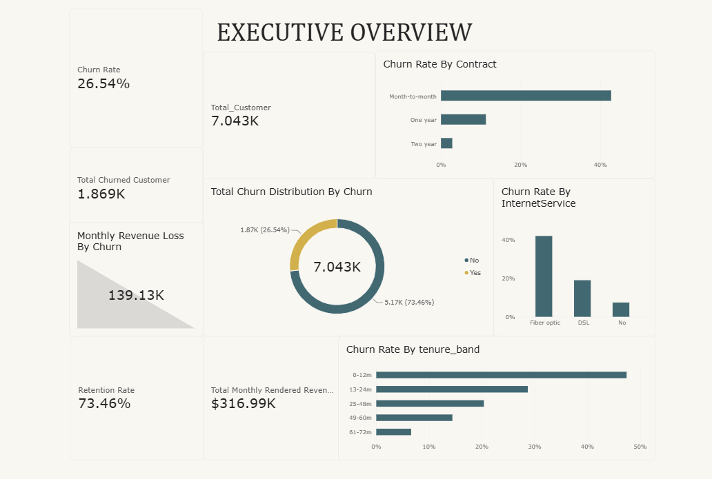
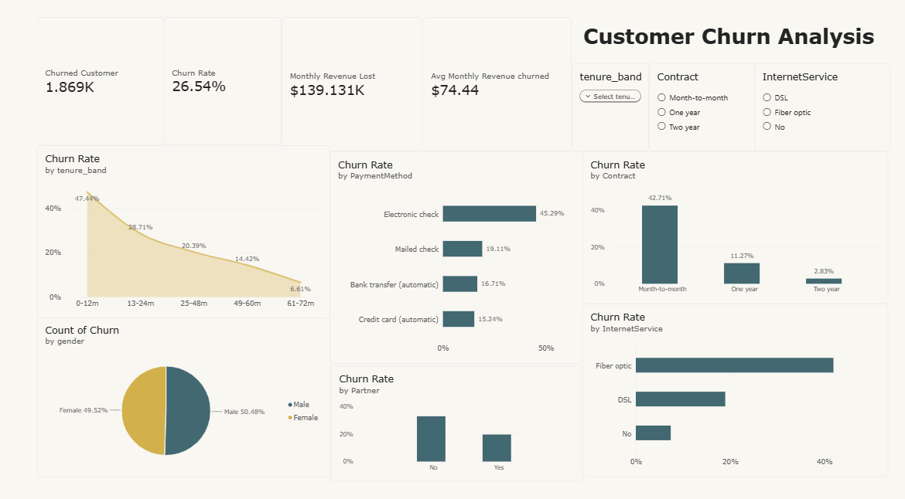
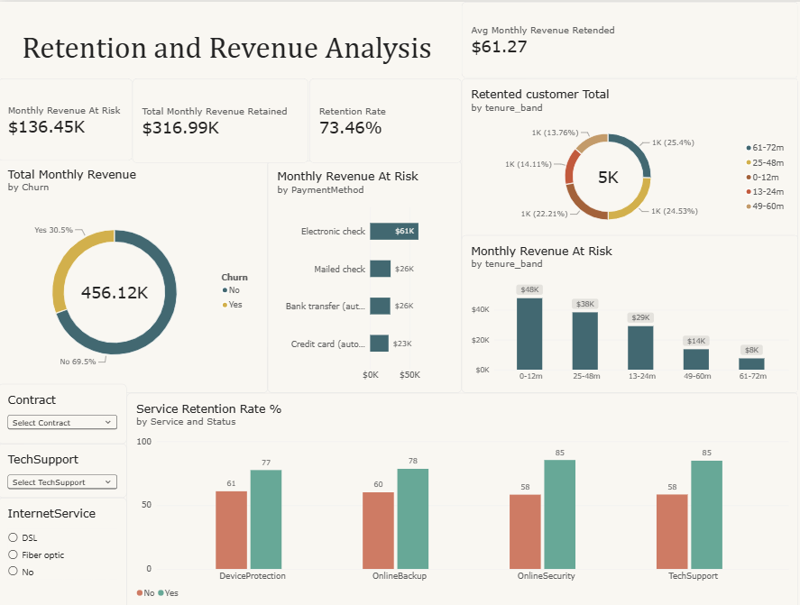

# Customer Churn & Retention Analytics

## Project Overview

This project analyzes customer churn in a telecommunications company to understand why customers leave, identify high-risk customer segments, and uncover opportunities to improve customer retention and protect monthly revenue.

The project uses Python for data cleaning and exploratory data analysis, SQL for business analysis, and Power BI for interactive dashboards.

## Business Problem

We noticed that customers are leaving the company but needs a clearer understanding of:

- What percentage of customers are churning?
- Which customer segments have higher churn?
- Which services and contract types are associated with customer retention?
- How much monthly revenue is being lost or is at risk?
- What actions could help improve customer retention?

## Tools & Technologies

- **Python:** Data cleaning and exploratory data analysis
- **Pandas / NumPy:** Data manipulation
- **Jupyter Notebook:** Analysis and documentation
- **SQL / SQLite:** Data querying and business analysis
- **Power BI:** Interactive dashboards and data visualization
- **DAX:** Measures and KPI calculations
- **Git & GitHub:** Version control and project sharing

## Project Workflow

1. **Data Cleaning:** Prepared the telecom customer dataset for analysis using Python.
2. **Exploratory Data Analysis:** Examined customer characteristics and churn patterns.
3. **SQL Analysis:** Used SQL queries, aggregations, CTEs, ranking functions, and `UNION ALL` to investigate churn segments and service retention.
4. **Power BI Dashboard:** Built a three-page interactive dashboard to present churn trends, customer segments, retention, and revenue exposure.

## Key Findings

- The overall customer churn rate was approximately **26.54%**.
- Month-to-month contracts, electronic check payments, and fiber optic internet were among the segments associated with higher churn in the analysis.
- Customers with shorter tenure showed higher churn patterns.
- The service retention analysis showed a difference between customers with and without selected add-on services. The comparison should be interpreted as an association, not proof that the services cause retention.
- The dashboard highlights monthly revenue lost and remaining revenue at risk to help prioritize retention efforts.

## Power BI Dashboard

The dashboard contains three pages:

### 1. Executive Overview

Provides a high-level view of customer numbers, churn, retention, and monthly revenue indicators.



### 2. Customer Churn Analysis

Explores churn patterns across contract types, payment methods, internet services, and customer characteristics.



### 3. Retention & Revenue Analysis

Examines service retention, revenue exposure, and high-risk customer segments.



## Project Structure

```text
## Project Structure

```text
project git1-customer-churn/
│
├── py scripts/
│   └── 01_cleaning_eda.ipynb
│
├── sql/
│   └── 02_sql_analysis.ipynb
│
├── data/
│   ├── telco.db
│   ├── telco_clean_using_py.csv
│   └── WA_Fn-UseC_-Telco-Customer-Churn.csv
│
├── power bi/
│   └── Customer_Churn_Dashboard.pbix
│
├── screenshots/
│   ├── executive_overview.png
│   ├── customer_churn_analysis.png
│   └── retention_revenue_analysis.png
│
├── reports/
│
├── requirements.txt
├── .gitignore
└── README.md

```
## Business Recommendations

- Review pricing, contract options, and retention offers for month-to-month customers.
- Investigate customer experience among electronic check payment users.
- Examine service quality and support needs among fiber optic customers.
- Prioritize early-tenure customers with onboarding and engagement initiatives.
- Evaluate add-on service adoption and its relationship with customer retention.
- Use revenue-at-risk indicators to prioritize customer retention efforts.

## How to Explore This Project

1. Review the Python notebook for data cleaning and exploratory analysis.
2. Explore the SQL notebook for business queries and findings.
3. Open the Power BI file to interact with the dashboard.
4. Review the dashboard screenshots above for a quick overview.

## Author

[Aman Mathew]

## Note

Dataset source and attribution: 
[Kaggel Data Sources: Telco Customer Churn-WA_Fn-UseC_-Telco-Cu and URL=https://www.kaggle.com/code/danishmubashar/telco-customer-churn-80-accuracy/input?select=WA_Fn-UseC_-Telco-Customer-Churn.csv ]

This project is intended for learning and portfolio demonstration purposes.